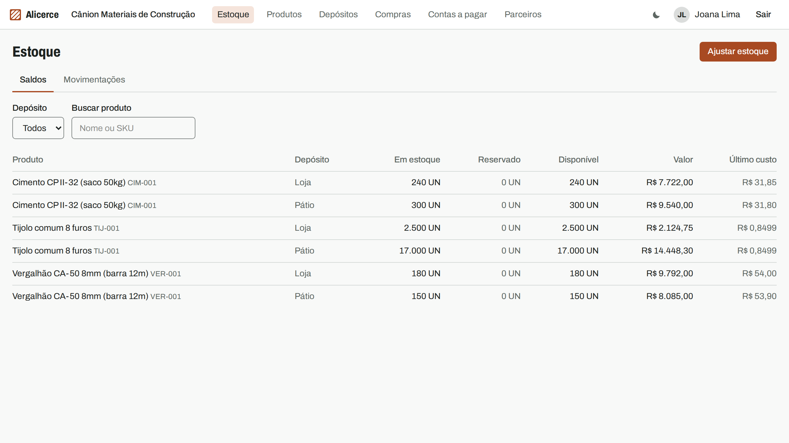
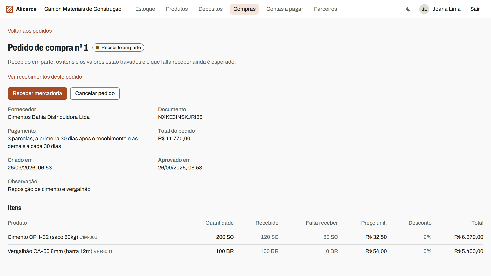
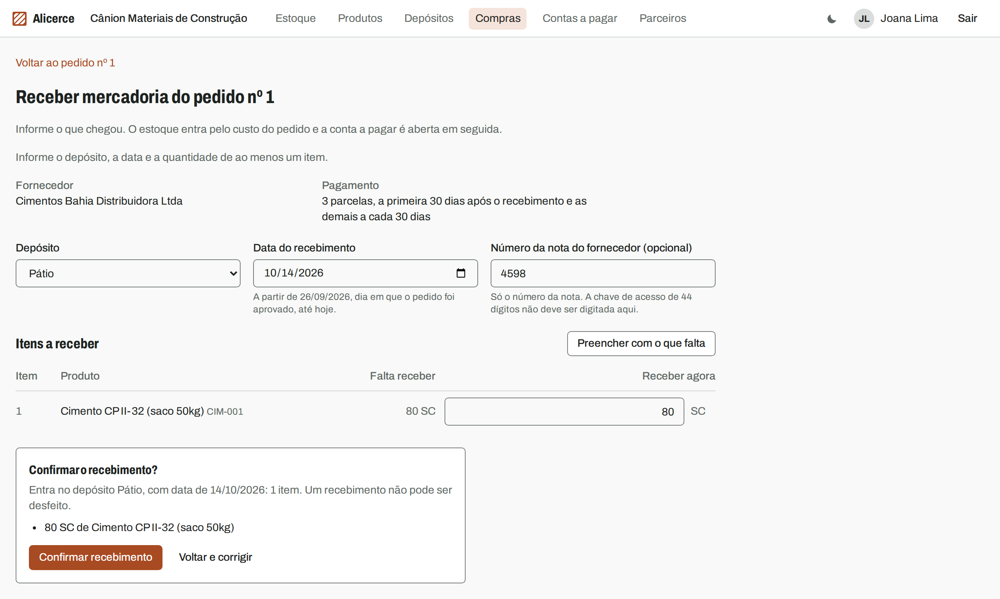
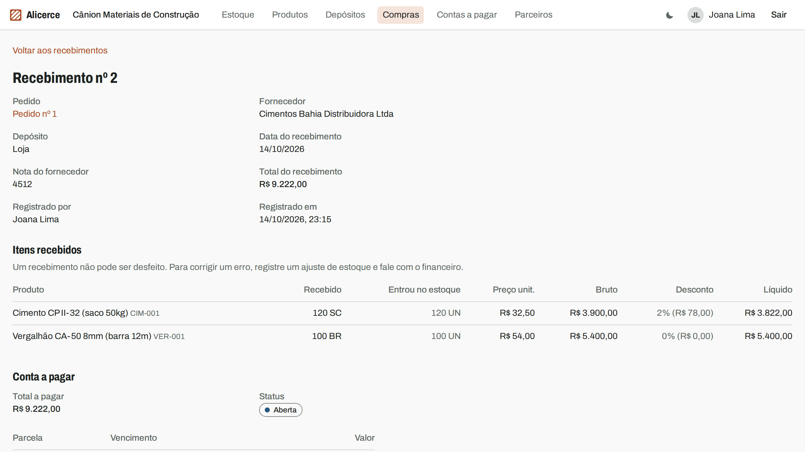
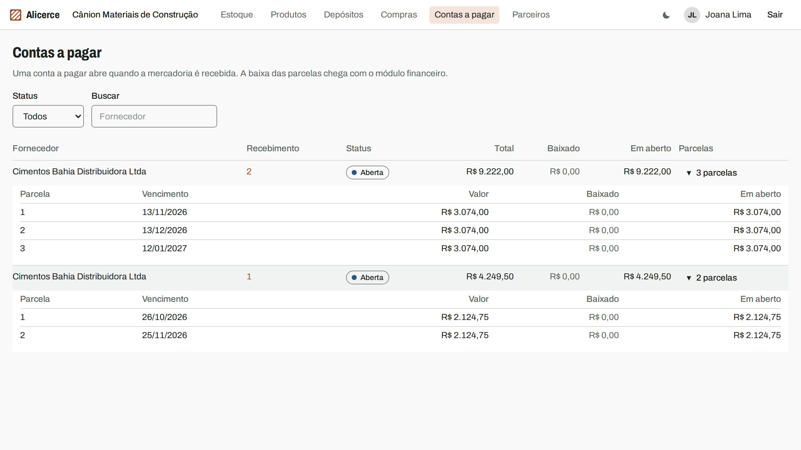
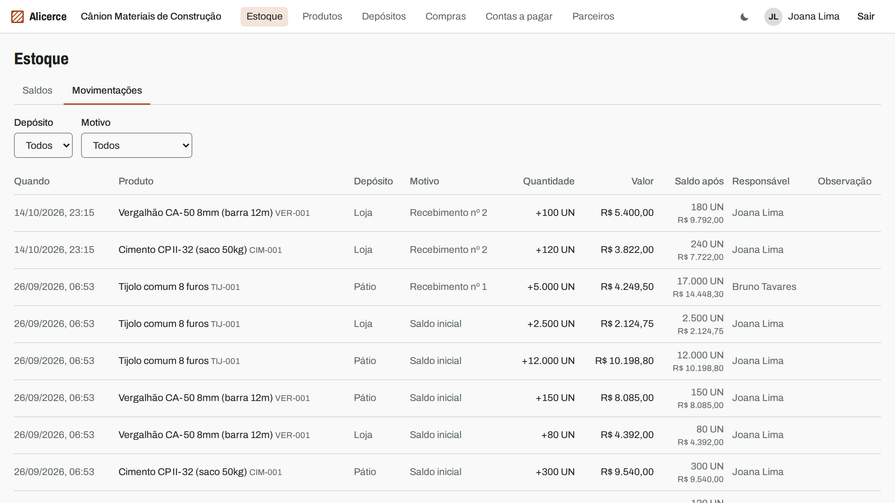
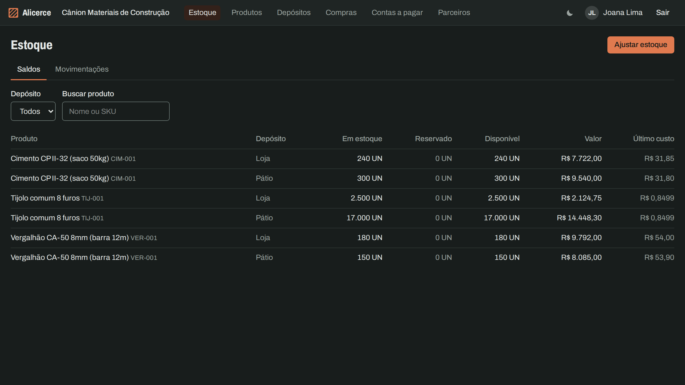

# Alicerce

[](https://github.com/TiagosailE/alicerce/actions/workflows/ci.yml)
[](https://github.com/TiagosailE/alicerce/actions/workflows/audit.yml)
[](https://github.com/TiagosailE/alicerce/actions/workflows/codeql.yml)
[](LICENSE)

[Leia em português](README.pt-BR.md)

A multi-tenant ERP for small Brazilian distributors. Its core is the closed loop of purchasing, inventory, sales and finance, where every step leaves the others consistent: receiving goods raises stock and creates the payable in one transaction, and invoicing a sale will issue stock and create receivables the same way. The consistency rules live in the domain and, wherever Postgres can express them, in the database too.

The demo company is a fictional building materials distributor in Paulo Afonso, Bahia, that buys bricks by the thousand and cement by the bag and sells them by the unit. A second, smaller company exists to prove that one organization can never see another's data. Every name, CPF and CNPJ in the seeds is generated.



## Status

**In development.** The project is built in vertical slices, each one going from migration to screen with its authorization, tenant isolation and OpenAPI updates. It is not deployed yet; the hosting plan is in [docs/deploy.md](docs/deploy.md).

| # | Slice | State |
|---|---|---|
| 0 | Foundation: CI, security scanning, Docker image, architecture and security docs | done |
| 1 | Identity and access: organizations, roles, sessions, invitations, audit trail | done (invitation acceptance and password reset have no screen yet) |
| 2 | Master data: products, units with purchase conversion, categories, warehouses, customers and suppliers | done |
| 3 | Inventory: balances, an append-only movement ledger, count adjustments at average cost | done |
| 4 | Purchasing: purchase orders, partial receipts, payables | done |
| 5 | Sales: reservation, invoicing that issues stock atomically, cancellation | next |
| 6 | Finance: settlements, reversals, overdue list, cash position | planned |
| 7 | Hardening: TOTP, session management | planned |

The full scope, the invariants and the roadmap are in [docs/scope.md](docs/scope.md).

## Screenshots

| | |
|---|---|
|  |  |
| A purchase order received in part: 120 of 200 bags so far | Receiving the rest, with a review step before anything is written |
|  |  |
| The receipt: stock in at the order cost, discount itemized, payable opened | Payables created by receipts, split into installments |
|  |  |
| The movement ledger, each line with its value and the balance after it | Dark theme |

The interface is in Brazilian Portuguese; code, API and documentation are in English.

## Architecture highlights

- **Tenant isolation in two layers.** Every tenant table carries `organization_id`, the application scope fails closed without a current organization, and Postgres row level security filters every query by a per-request setting. The whole test suite connects as the same non-superuser role the app uses in production, so every spec runs under RLS, and raw SQL specs prove another organization's rows are invisible. A route inventory spec fails the build when an `/api/v1` route has no isolation test. ([ADR 0003](docs/adr/0003-tenant-isolation.md))
- **An append-only stock ledger.** Stock lives in a balance row per product and warehouse plus an immutable ledger of movements, each storing its quantity, its value and the balance after it. UPDATE, DELETE and TRUNCATE are refused by privileges and triggers, and a CHECK keeps on-hand from going negative without a recorded allowance. ([ADR 0016](docs/adr/0016-stock-balances-ledger-and-count-adjustments.md))
- **Pessimistic locks in one global order.** Every command that touches stock locks rows in the same order (idempotency key, documents and lines, balances by product and warehouse, titles, counters) with a lock timeout that answers `409 conflict_retry` instead of hanging. Concurrency specs release real threads together. ([ADR 0004](docs/adr/0004-stock-locking.md))
- **Idempotent critical writes.** Receiving goods and stock adjustments (and, next, invoicing and settlements) require an `Idempotency-Key`; a replay returns the original result and the same key with a different request is refused. ([ADR 0005](docs/adr/0005-idempotency-keys.md))
- **Optimistic concurrency on master data.** Editing a product, a partner or a draft purchase order sends back the `revision` it read; a newer one on the server answers `409 stale` and writes nothing, so two people editing at once never silently overwrite each other. ([ADR 0015](docs/adr/0015-concurrent-edits-and-master-data-that-documents-reference.md))
- **Money as integer cents.** No floats anywhere in the money path, quantities with three decimals, and every rounding happens at a named point, including how a total is split into installments. ([ADR 0006](docs/adr/0006-money-and-quantities.md))
- **Explicit state machines and an audit trail.** Orders, receipts and titles change state only through transition tables on the model; every relevant change writes an append-only audit event that the database protects against UPDATE and DELETE. ([ADR 0009](docs/adr/0009-state-machines.md), [ADR 0010](docs/adr/0010-audit-trail.md))
- **Schema-first API.** The OpenAPI document is written first, request specs validate every response against it, and the SPA's TypeScript client is generated from it; CI fails if the generated types drift. ([ADR 0011](docs/adr/0011-openapi-schema-first.md))
- **Security as a checklist with evidence.** A STRIDE [threat model](docs/threat-model.md) over sign-in, invoicing and stock, and a [security checklist](docs/security.md) targeting OWASP ASVS level 2 where each control points to its code or test. CPF and CNPJ are encrypted at rest and masked in lists ([ADR 0012](docs/adr/0012-personal-data-encryption.md), [ADR 0014](docs/adr/0014-partner-personal-data-visibility.md)).

Seventeen architecture decision records explain the choices that are hard to reverse: [docs/adr](docs/adr/README.md). How the pieces fit together is in [docs/architecture.md](docs/architecture.md).

## Stack

| Layer | Choice |
|---|---|
| Backend | Ruby 4.0, Rails 8.1 in API mode, Pundit, Solid Queue and Solid Cache in Postgres |
| Database | PostgreSQL 18 with row level security, schema kept as `db/structure.sql` |
| Frontend | React 19, TypeScript, Vite, Tailwind CSS 4, TanStack Query, a client typed from the OpenAPI document |
| Tests | RSpec (coverage floor of 90% lines and 80% branches), Vitest with Testing Library, Playwright against the production image |
| CI | GitHub Actions: lint, types, audits, Brakeman, tests, the production image booted with a memory budget, a browser test that fails on any CSP violation, Trivy, gitleaks, dependency review, CodeQL |
| Hosting (planned) | One Docker image on Render, Postgres on Supabase ([ADR 0002](docs/adr/0002-free-hosting.md)) |

## Running locally

Requirements: Ruby 4.0.7 and Node 24 (versions in `.ruby-version` and `.node-version`, read by mise), and Docker for Postgres.

```sh
git clone https://github.com/TiagosailE/alicerce.git
cd alicerce
bin/setup
```

`bin/setup` installs dependencies, starts Postgres with Docker Compose on 127.0.0.1:5433, creates and seeds the database, and starts Rails (port 3000) and Vite (port 5173). Open http://localhost:5173 and sign in with a seeded user; in development they all use the password `alicerce-demo-2026`.

| User | Role | Company |
|---|---|---|
| `joana.lima@canion.example` | owner | Cânion Materiais de Construção |
| `bruno.tavares@canion.example` | purchasing | Cânion Materiais de Construção |
| `rafael.souza@canion.example` | sales | Cânion Materiais de Construção |
| `marcia.alves@canion.example` | finance | Cânion Materiais de Construção |
| `pedro.rocha@serradourada.example` | owner | Ferragens Serra Dourada |

`bin/ci` runs every check that can run locally. The other commands, the folder layout and the conventions are in [CONTRIBUTING.md](CONTRIBUTING.md).

## License

[MIT](LICENSE)
